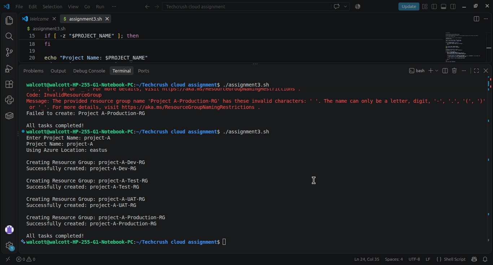
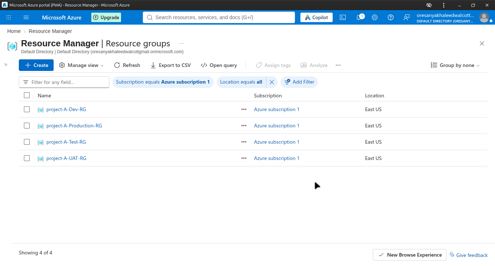
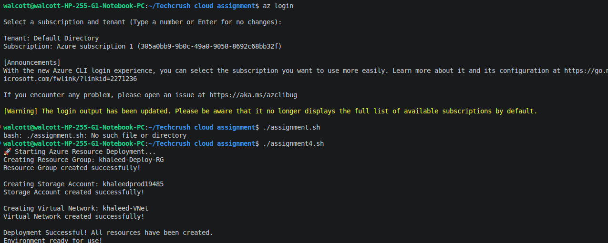
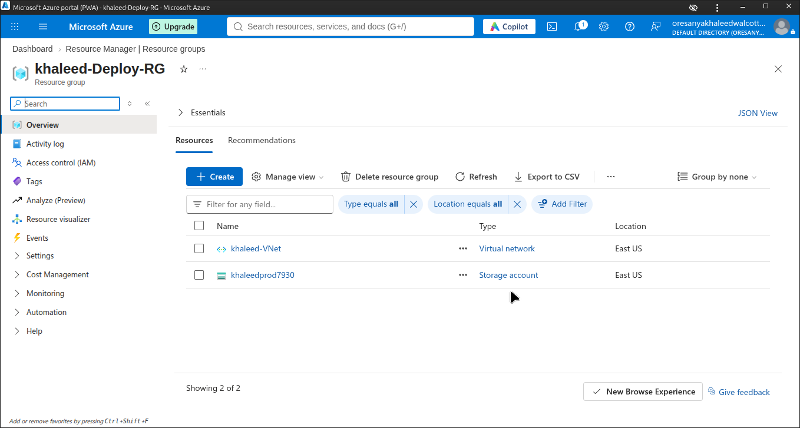

# Azure Deployment Scripts

This repository contains Bash scripts designed to automate the creation of Azure resources using the Azure CLI. These scripts were built to solve real-world scenarios by replacing repetitive manual tasks with fast, reliable, and repeatable code.

## Prerequisites
Before running these scripts, ensure you have:
1. **Azure CLI installed** on your machine.
2. Logged into your Azure account via the terminal:
   ```bash
   az login
   ```

---

## Script 1: Automated Resource Group Creation (`assignment3.sh`)

**Scenario:** A company was wasting time manually creating identical Resource Groups for new projects every week. 

**Solution:** This script prompts the user for a project name, then automatically provisions four environment-specific Resource Groups (`Dev`, `Test`, `UAT`, `Production`).

**How to run:**
```bash
chmod +x assignment3.sh
./assignment3.sh
```

### Evidence of Execution

**Terminal Output:**

)

**Azure Portal Verification:**
*(Shows the newly created Resource Groups inside my Azure account)*


---

## Script 2: One-Click Environment Deployment (`assignment4.sh`)

**Scenario:** Non-technical staff needed a simple way to deploy a basic Azure environment without having to understand CLI commands or type in variables.

**Solution:** This script is a fully automated, zero-input deployment. Running it creates a Resource Group, a Storage Account (with a unique name using `$RANDOM`), and a Virtual Network. It utilizes `set -e` to ensure the script stops immediately if any command fails.

**How to run:**
```bash
chmod +x deploy.sh
./assignment4.sh
```

### Evidence of Execution

**Terminal Output:**

**Azure Portal Verification:**


---

## 🧠 Key Concepts Applied
*   **User Input Validation:** Using `read -p` and `if` statements to prevent empty inputs.
*   **Looping:** Using Bash `for` loops to iterate through multiple environments.
*   **Error Handling:** Using `set -e` and `if/else` blocks to catch failed Azure commands.
*   **Azure Naming Constraints:** Implementing `$RANDOM` to ensure Storage Account names are globally unique.
